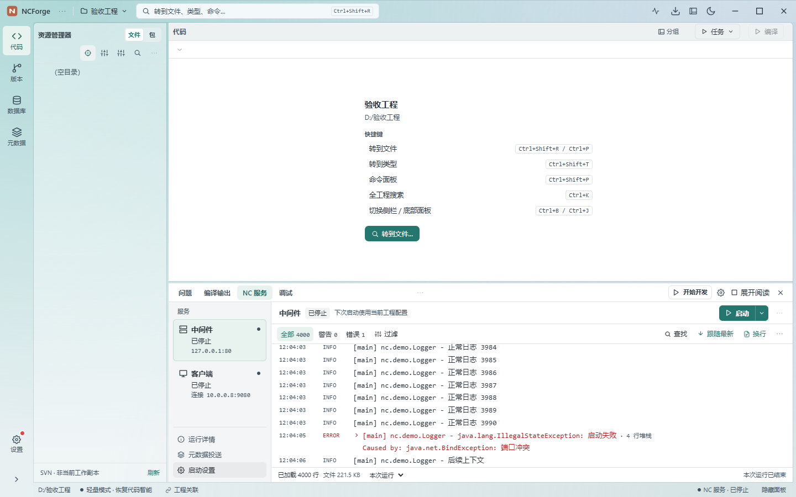
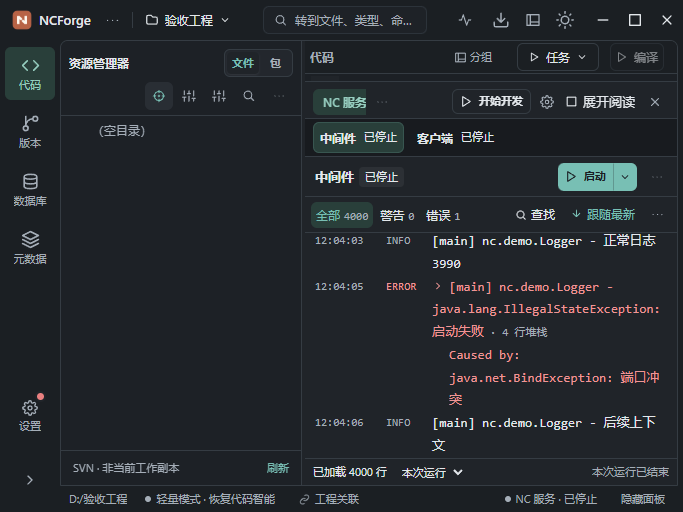

# NC 服务与控制台实施验收

日期：2026-11-06。状态：用户确认的 P0/P1 方案已实施，受影响测试与生产界面场景通过。全仓门禁仍有其他模块阻塞，尚未完成真实 NC 环境及安装包真机验收。保留工作区代码，未打安装包、改版本或提交。

方案：[NC 服务与控制台升级方案](./NC服务与控制台升级方案-2026-11-06.md)。已批准效果：[双主题交互稿](../design/NC服务与控制台交互稿-2026-11-06.html)。以下截图来自正式前端生产产物，不是设计稿。

## 1. 已落地的体验

| 范围 | 最终行为 |
| --- | --- |
| 服务页布局 | 左侧选择中间件或客户端，右侧提供对应启停与大控制台；窄面板改为横向服务选择。运行详情、元数据投送和启动配置按需打开。 |
| 阅读空间 | 支持展开阅读、恢复原停靠高度；保留编辑器节点。面板缩窄后当前页签保持可见，工具栏次要操作收进更多菜单。 |
| 双主题 | 浅深主题同时兼容玻璃和实色；日志正文使用稳定底色、13px 等宽字，可调整字号和软换行。 |
| 服务反馈 | 环境检查、classpath 准备、投送、JVM 创建和等待端口显示真实阶段及用时；无可量化总量时使用等待动画。准备可取消，端口冲突但 JVM 尚在准备时仍可停止启动。 |
| 独立操作 | 启停、重启、调试和命令行绑定所选服务；同帧重复点击及相互冲突的操作加同步锁。状态读取失败显示未知，隐藏旧阶段和旧告警。 |
| 健康依据 | 中间件只确认本进程监听；客户端显示实际连接 host/port 及可达性。工作台数据库独立列出，NC 登录及业务健康标为未验证。 |
| 开始开发 | 可选编译 → 单次投送 → 启动或复用中间件 → 等待客户端实际连接目标可达 → 启动客户端 → 可选调试附加。失败和取消停止后续步骤，按运行身份取消本流程未完成的新准备，保留原有进程。 |
| 普通日志 | stdout 左对齐，仅明确的 Java 异常栈归组；长命令可展开、复制全文。 |
| 查找和排查 | Ctrl+F 查找保留上下文，支持高亮、前后匹配和自动展开异常；内容过滤独立。异常原文、前后上下文和源码定位可用，同名类多候选需选择。 |
| 来源与历史 | 中间件、客户端、本次、上次各自记忆筛选与阅读状态。向上滚动暂停跟随，新增日志不抢位置；更早日志按需分页，显示真实字节范围。 |
| 复制与导出 | 区分选区、当前异常和已加载匹配日志。完整导出读取磁盘快照，已加载匹配导出明确范围；原生选址、写入进度、取消、原子落盘和临时文件回收已接线。 |
| 清屏与归档 | 清屏快进读取偏移，保留磁盘文件；失败保留日志。上次运行打开对应归档位置，空归档显示 0 B，不借用本次文件大小。 |

启动、停止、重启、端口处理、元数据操作及日志导出复用全局任务反馈；读取失败提供重试，不把请求已接受当成启动成功。切工程、卸载和晚到响应按工程与运行身份隔离，防止误更新或误停止下一次运行。

## 2. 验证结果

| 检查 | 结果与范围 |
| --- | --- |
| 受影响 Vitest | 21 个文件、120 项通过；覆盖服务操作、取消、日志分页和轮转、来源定位、组合流程、编译接线与展开保留编辑器。 |
| Rust 定向测试 | `service_log::` 7 项、server 匹配 21 项、`client_cmds` 3 项，共 31 项通过；归档位置接线后又执行日志 7 项通过，最新后端已编译。全程经 rust-gate，编译 jobs=1。 |
| 最终生产前端 | `npm run vite:build` 通过，包含 TypeScript 检查与 Vite 生产构建。 |
| 生产界面回归 | `node --test scripts/service-console-production.test.mjs` 通过；使用本机 Edge 单个无头浏览器，正式静态资源、安装配置 CSP 和模拟 IPC。 |
| ESLint | 全仓通过。 |
| 前端约定 | 组件体量、UI 约定、设计 token 棘轮及 224 条命令契约通过。 |
| 定向 Rust 格式 | service_log、service_log_cmds、server、server_cmds、client_cmds 五个主体文件 rustfmt check 通过。 |
| 本批文本 | 定向 diff 空白检查通过，文本采用 LF。 |

生产回归覆盖浅深 × 玻璃/实色 × 4 尺寸共 16 组：1440×900、1024×540、683×512（高缩放等效空间）、560×700。常规日志正文高 223px，紧凑高 225px；没有外部横向溢出。浏览器脚本错误与 CSP 违规为 0。原始测量见 [检查记录](./NC服务与控制台实施验收-2026-11-06/检查记录.json)。

同一回归还检查展开恢复、4000 行可达且 DOM 有界、普通输出缩进、完整命令复制、查找与栈展开、来源设置、按需历史、清屏保留磁盘、导出取消、独立停止客户端、组合流程失败及取消、实际客户端目标、状态未知、日志读取失败恢复、暂停新增不抢位置及详情关闭后的焦点恢复。

最后补充的空归档检查先复现了“文件 195.3 KB”误用本次大小的问题，修正后最终回归通过；[修复前取证](./NC服务与控制台实施验收-2026-11-06/空归档大小修复前.json)仅保留为已修缺陷的复现证据。

## 3. 性能与体积

- 单次日志读取上限 256KB，按原始字节记录偏移，兼容 UTF-8/GBK 逐行解码与尾部未换行数据。
- 最新窗口最多 4000 行、约 8MiB 文本；历史片段单独有界读取。动态测高虚拟列表挂载可见行，测高缓存随行淘汰，不随运行时间无限增长。
- 运行日志可见时最多每 500ms 增量读取，隐藏来源及隐藏工作台停止轮询；上次日志不持续轮询。启动观察每秒让出并有观察次数上限，组合目标等待有超时及取消。
- 完整导出按固定磁盘快照做有界流式 I/O，按已写入字节反馈进度；取消或源文件截短不覆盖已有目标，临时文件回收。
- 保留其他工作区改动，通过 Vite 插件在内存中还原本批服务模块至 HEAD 做同源对照。最终增加 **36.32KB raw / 14.64KB gzip**；预算只增加 **37KB / 15KB**，最大块上限仍为 3171KB。对照不包含编译入口的少量 skipDeploy 参数接线，不将其声称为精确到字节的完整功能成本。详见 [体积归属](./NC服务与控制台实施验收-2026-11-06/体积归属.json)。
- 本轮重任务串行，Rust 使用 1 路；已观察可用内存约 3.3–4.7GiB，最终空闲采样约 4.65GiB。这是有缓存的本地验收样本，不作为冷构建内存上限。

## 4. 全仓门禁与验收边界

以下问题未通过扩大本批范围或整体更新基线消除：

1. **全仓 cargo fmt --check 未通过**：其他批次及存量文件存在格式差异；本批五个 Rust 主体文件定向检查通过。
2. **全仓 Clippy 未通过**：最近记录中，元数据生成模块 `bmf_gen_write.rs:14` 和 `commands/bmf_generation_cmds.rs:172` 分别触发 8/7、9/7 参数数量限制。本批日志导出改为从 AppHandle 取得状态，未加规则豁免。见 [Rust 检查记录](./NC服务与控制台实施验收-2026-11-06/Rust检查.txt)。
3. **Rust 产物缓存超额**：记录时 target/debug 约 10.08GB，超过 6GB；依赖 debug=false 配置正确，属于累积产物。本轮没有临时文件泄漏，未清理其他会话缓存。
4. **全仓 JS 体积未过预算**：最终约 5092KB raw / 1464KB gzip，相对本批已调整的 5048KB / 1450KB 预算仍超约 44KB / 14KB；同源对照保留的其他模块增长未被本批预算吸收。最大块仍在 3171KB 上限内。

为完成全仓生产构建和后端编译，本批还做了最小接线修复：生成预览使用 Monaco 公共 getLineChanges() API；元数据写入调用补齐安全参数并保留白名单强制；ECJ 契约测试补齐 Node timers/perf_hooks import。未重构这些模块。

本次没有启动真实 NC 服务、连接业务库、实际投送元数据或改动真实源码。浏览器模拟 IPC 验证界面与命令参数，Rust 测试验证分页、编码、快照、取消和运行状态逻辑；**原生保存窗口、真实 JVM 端口等待、登录业务健康、真实调试附加及安装包窗口行为尚需真机确认**。因此交付结论是“批准方案已落地，已测场景通过”，不能宣称全部环境没有 bug。

## 5. 产品截图

浅色玻璃常规停靠：

深色实色紧凑布局：

展开阅读、失败与取消等截图见 [验收产物目录](./NC服务与控制台实施验收-2026-11-06/)。重跑入口是 `desktop/scripts/service-console-production.test.mjs`；后端命令与产品前端均已保留在工作区。
