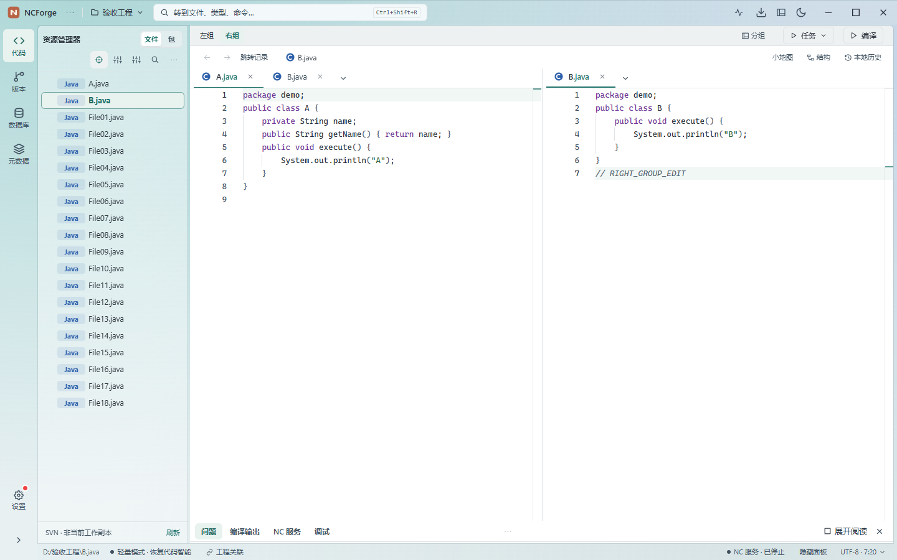
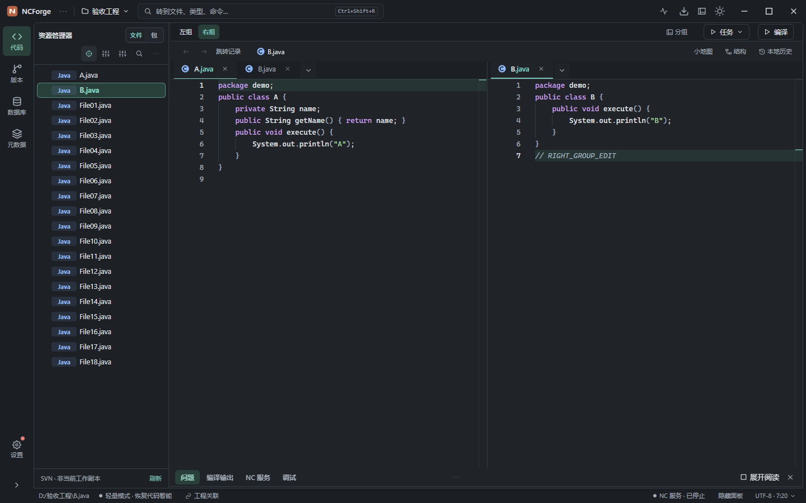
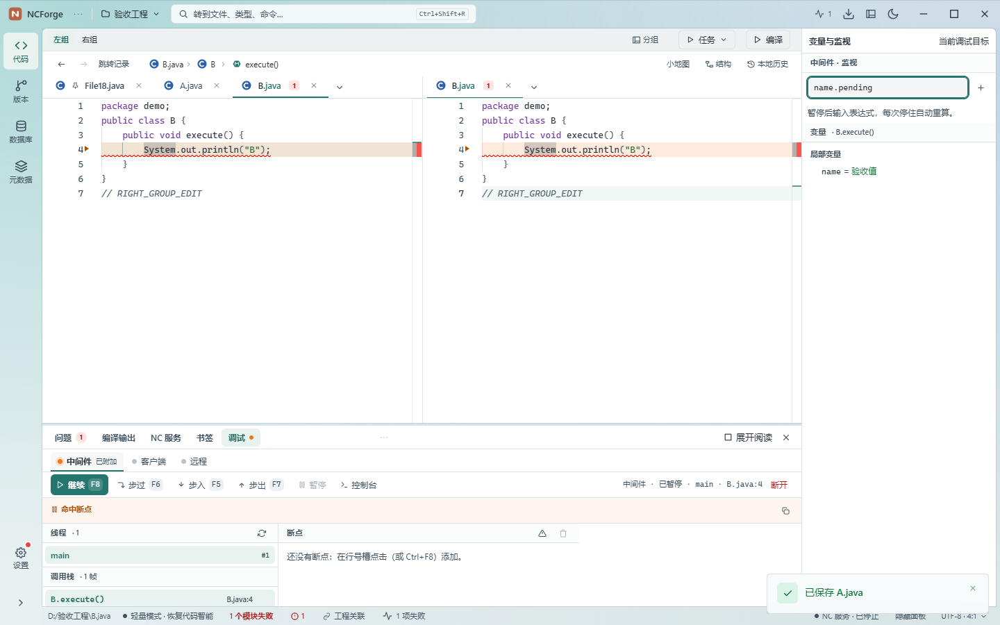
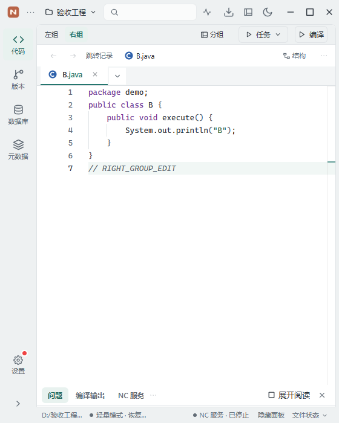

# 代码工作台布局深化实施验收

日期：2026-11-06。用户批准 [推荐 B 方案](./代码工作台布局深化方案-2026-11-06.md) 的 P0/P1，并要求直接实施、不出设计稿。功能已落地，已测前端场景通过；全仓 JS 体积门禁仍超额，真实 NC 与安装包原生行为未纳入此次验收。代码保留在工作区，未构建安装包、递增版本或提交。

## 1. 已实施的工作流

| 范围 | 最终行为 |
| --- | --- |
| 任务布局 | 编码、排错、调试三种布局；可锁定与恢复。新编译失败、新调试暂停可以引导对应布局；锁定或停留其他页面时保留用户选择，缓存结果不反复抢布局。 |
| 空间记忆 | 文件树、搜索、数据库等侧栏分别记忆宽度；底部工具分别记忆高度。拖动即时反馈，配置延迟合并保存；键盘方向键调节，连续两次 Enter 恢复默认。 |
| 底部工具 | 问题、编译输出、NC 服务、调试常驻；调用层级、类型层级、待办和书签通过更多打开，可长期固定。空问题面板默认紧凑，日志、缺组件和失败不会被空状态规则隐藏。 |
| 展开阅读 | 所有底部工具统一展开、恢复和关闭。编辑器保持挂载，展开不覆盖保存的停靠尺寸；服务低窗口保留默认 360px 停靠高度，手动缩小的偏好仍有效。 |
| 正式双编辑器组 | 各组独立标签、活动文件、光标、阅读位置、导航历史与最近使用记录；支持移动、交换、合并、拖动比例和恢复等宽。可用编辑区不足 850px 时只展示焦点组，保留另一组状态。 |
| 文件安全 | 同文件双开共享模型与撤销内容；关闭一个视图保留另一组未保存修改，最后视图走确认守卫。慢读取、切工程与晚到定位保留正确对象。保存快捷键按所属编辑器实例注册。 |
| 多文件管理 | 所有标签可搜索、按最近使用或未保存筛选；长期钉住与预览转正式标签区分。批量关闭保护钉住文件及独有未保存内容，共享视图关闭不丢模型。 |
| 文件树与阅读 | 资源动作按任务归组，快速过滤按工程隔离，支持清除与 Escape 返回焦点；长路径中间折叠，阅读工具按容器宽度收敛，结构当前方法保持可见。长文件提示使用摘要及详情。 |
| 状态与智能提示 | 文件状态集中在菜单，未保存仍常驻；补全、参数提示、悬浮文档、定义预览和诊断使用浅深主题 token；内联错误提供短摘要和额外条数。继续沿用代码智能范围与就绪反馈。 |
| 问题闭环 | 工程、模块、当前文件范围，编译完成时间及磁盘版本快照，选中问题查看源码上下文。不同路径分隔符与大小写复用同一标签和模型，点击定位正确文件及行号。 |
| 编译阅读 | 模块摘要、问题定位、原始输出三个层次；原始输出最多保留 5000 行，按可见区域渲染；缓存淘汰时尽量保持当前阅读锚点，新增输出不强迫跳到底部。 |
| 搜索闭环 | 命中上下文预览、前后连续定位、结果展开与恢复；跨工程命中保留所属工程的权威路径。稳定的 portal 容器保留结果和滚动状态。 |
| 调试闭环 | 宽屏右侧变量与监视检查器，窄屏放回底部；线程、调用栈与控制台保留在工具区。停靠移动保留监视草稿、变量展开和焦点，不触发变量失焦提交；暂停后重新读取线程，晚到栈帧不抢用户源码。 |

浅深主题均兼容柔光玻璃和实色。玻璃用于外壳，代码、日志与检查器正文保持稳定实底。控件提供点击、焦点、禁用和等待反馈，正文切换不增加入场位移；减少动态效果模式保留状态提示。

## 2. 测试与生产验收

| 检查 | 结果 |
| --- | --- |
| 完整前端 Vitest | 327 个文件、2169 项通过，使用最多 2 个 worker。之后补充的路径、服务高度与线程修复又执行最新定向测试：11 个文件、56 项通过。未把定向测试数量重复加到全量结果中。 |
| 最新生产构建 | `npm run vite:build` 通过，包含 TypeScript 与 Vite 生产构建；产物包含编辑器快捷键、路径复用和暂停线程刷新修复。 |
| 代码工作台生产回归 | `node --test scripts/code-workbench-production.test.mjs` 通过；20 组主题/尺寸测量，另验证双组保存、20 标签、共享模型关闭、问题定位、搜索展开、编译日志及调试检查器。 |
| 服务控制台回归 | `node --test scripts/service-console-production.test.mjs` 通过；16 组主题/尺寸及既有服务启停、取消、组合开发流程、日志查找、分页、清屏和导出场景。 |
| 静态门禁 | 全仓 ESLint、组件/Hook 体量、设计 token、UI 约定及 224 条命令契约通过。 |
| 定向审查 | 按源码与 diff 审查焦点、共享模型、未保存守卫、旧响应、事件与停靠生命周期；审查中发现的问题已修复并验证。当前未找到 requesting-code-review skill 或自定义 code-review 命令，采用手动定向审查。 |
| JS 体积门禁 | 未通过，详见下节；没有整体扩大预算。 |

两个生产回归均使用正式 `dist`、安装配置 CSP、单个本机 Edge 无头浏览器和模拟 IPC；浏览器脚本错误与 CSP 违规均为 0，所有主题启用减少动态效果。模拟命令只操作浏览器内夹具，不写真实源码、不启动 JVM。

代码区测量以 Monaco 正文节点高度为准，排除文件标签；浅深 × 玻璃/实色共 20 组均无外部横向溢出：

| 窗口 | 实际代码正文高度 | 行为 |
| --- | --- | --- |
| 1440×900 | 695px | 双组各自保留可读空间。 |
| 1366×768 | 563px | 高于方案的 380px 目标。 |
| 1024×540 | 335px | 高于方案的 300px 目标，窄编辑区显示焦点组。 |
| 683×512 | 307px | 高缩放等效空间保持主操作可达。 |
| 560×700 | 495px | 资源侧栏使用可关闭的抽屉，关闭后代码与分组操作可用。 |

原始记录：[代码区测量](./代码工作台布局深化验收-2026-11-06/检查记录.json)、[服务测量](./NC服务与控制台实施验收-2026-11-06/检查记录.json)。

生产验收还修复了以下真实问题：新执行栏受旧空标签选择器隐藏；所有标签按钮随滚动迟到事件关闭；Monaco 全局动态快捷键调用另一编辑器的保存回调；问题路径分隔符差异重复创建模型；低窗口日志正文仅 214px；暂停清空线程后未重新请求线程列表。最新测试覆盖左右组实际保存路径、问题跳转后活动文件及第 4 行光标、可见线程列表，以及展开恢复后的监视草稿。

## 3. 性能、体积与资源

此次没有引入新的前端依赖。编辑器保持最多两组，内容共享已有模型；工具展开和检查器停靠复用稳定节点。底部拖动状态延迟 300ms 合并写配置；问题/源码上下文有界读取，编译输出保留 5000 行并只挂载可见区域。文件树过滤按工程最多缓存 16 份，隐藏工具沿用可见性门禁。

全仓 JS 生产产物约 **5129KB raw / 1477KB gzip**，最大块 **3172KB**。现有预算 **5073KB / 1458KB / 3171KB**，分别超约 **56KB / 19KB / 1KB**。gzip 使用 level 9；CSS 不计入该 JS 门禁。

本轮开始时保留的旧 `dist` 快照为 5214490 字节 raw、1499431 字节 gzip、最大块 3247203 字节。它与当前混合工作区不是可重建的同源隔离基线；只有编辑器组的一部分改前源码快照可靠，不能将前后全部差值归为本轮 P0/P1，也不能将其他批次超额纳入本批预算。没有整体还原工作区或执行 bundle:update。精确字节、预算和前后差值见 [体积记录](./代码工作台布局深化验收-2026-11-06/体积记录.json)。

重任务串行执行，Vitest 最多 2 个 worker，浏览器使用单个无头实例。最新生产构建启动可用内存约 3.39GiB、最低 2.16GiB、结束 3.63GiB；浏览器采样记录见 [代码验收内存](./代码工作台布局深化验收-2026-11-06/code-内存记录.json)、[服务验收内存](./代码工作台布局深化验收-2026-11-06/service-内存记录.json)。本轮观察到的构建最高消耗约 1.60GiB，属于现有依赖及缓存条件，不能当成 Rust 冷构建或真实 NC 启动所需内存。

## 4. 验收边界与交付

P0/P1 的布局和前端交互已完成。P2 的跨启动工程会话恢复、上下分组、任意停靠、多窗口及高级布局预设继续按方案独立评估。

本轮没有修改 Rust、重跑 Rust 门禁或启动真实 NC/JDT 服务；前端夹具验收不能证明真实 Java 补全正确率、JVM 调试附加、业务登录健康和安装包原生窗口行为。既有后端验收结论不在本报告中改写。因此结论是批准功能已实施、已测场景通过，仍有明确的体积门禁和真机验收边界。

截图来自正式前端生产产物：

变更已追加到 `CHANGELOG.md` 的 Unreleased。工作区保留所有其他批次修改，本次没有提交、打包或改版本。
